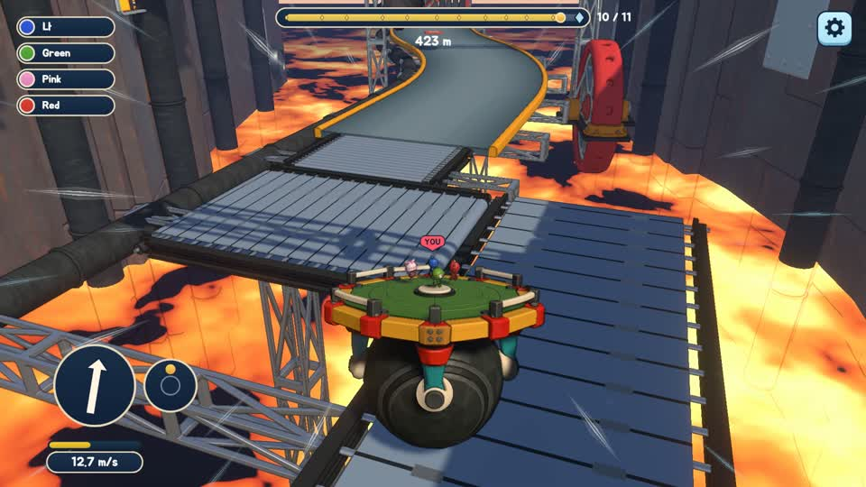
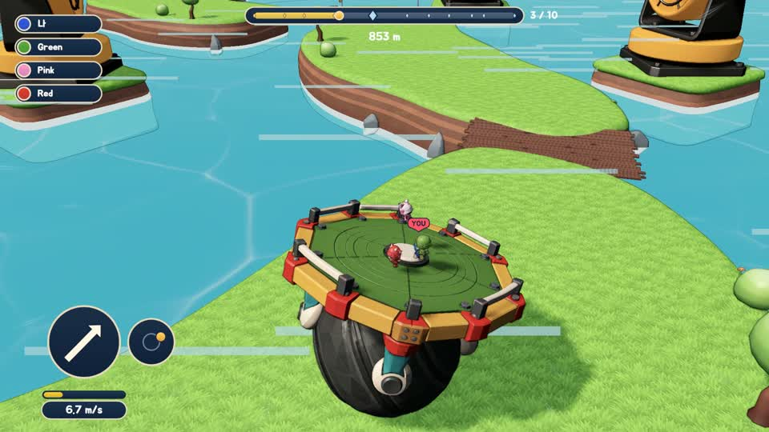

# Roll With Us!

**한 대의 모노휠을 함께 조종하는 1~4인 온라인 물리 협동 게임**

`Unity 6 (6000.3.23f1)` · `Photon Fusion 2` · `URP` · `Windows PC`

## 게임 소개

최대 네 명이 한 판 위에 올라 각자의 캐릭터를 움직입니다. 사람들이 앞으로 모이면 모노휠이 가속하고, 뒤로 이동하면 제동을 걸 수 있습니다. 굽이에서는 일부가 회전할 쪽으로, 나머지가 뒤쪽으로 옮겨 속도와 방향을 함께 맞춥니다. 점프와 내려찍기로 하중을 바꾸거나 동료를 잡아 판의 다른 쪽으로 던질 수도 있습니다.

방을 만든 뒤 **6자리 코드**를 공유하면 친구가 참가할 수 있습니다. 로비에서 캐릭터를 선택하고 공을 잡고 던지며 조작을 연습합니다. 모두 준비되면 호스트가 게임을 시작합니다. 모노휠이 코스에서 떨어지면 일행이 마지막 체크포인트에서 다시 출발합니다.

<table>
  <tr>
    <td align="center"><br><strong>Factory</strong></td>
    <td align="center"><br><strong>자연풍 스테이지</strong></td>
  </tr>
</table>

## 스테이지

- **Factory** · 용암 위 공장에서 해머와 측면 피스톤의 타이밍을 읽고, 바닥 톱날 사이를 지나며 균형을 잡습니다. 점프패드로 도약하고, 기름 웅덩이에서 미끄러짐을 제어하거나, 승강기와 이동 발판을 타고 다음 길로 넘어갑니다. [Factory 씬](Assets/3.%20Scenes/FactoryMap.unity)
- **자연풍 스테이지** · 독립적으로 만든 10개 구간을 하나의 코스로 연결하고, 구간 사이에 복귀용 체크포인트 9개를 배치했습니다. 횡풍에 맞서 하중을 옮기고, 얼음길에서 미리 감속하며, 낙석과 회전 발판의 타이밍을 읽습니다. 기억의 길은 진입부에서 경로를 미리 보여주고 출발하면 발판의 모습을 숨깁니다. [통합 맵 씬](Assets/3.%20Scenes/InGame/InGameMap%20Combined.unity) · [구간별 MapList](Assets/3.%20Scenes/InGame/MapList) · [MemoryPath.cs](Assets/1.%20Scripts/Gimmick/Pad/MemoryPath.cs#L27-L75)

## 조작과 실행

| 동작 | 키보드 | 게임패드 |
| --- | --- | --- |
| 이동 | `WASD` 또는 방향키 | 왼쪽 스틱 |
| 점프 | `Space` | 남쪽 버튼 (`A` / `×`) |
| 공중 내려찍기 | `Ctrl` | — |
| 잡기 / 놓기 | `E` | — |
| 들고 있는 대상 던지기 | `Q` | — |

키 배치는 [PlayerInputAction.inputactions](Assets/6.%20InputAction/PlayerInputAction.inputactions)에 정의되어 있습니다.

1. Unity Hub에서 프로젝트를 등록하고 [프로젝트에 지정된 Unity 버전](ProjectSettings/ProjectVersion.txt)으로 엽니다.
2. [Main.unity](Assets/3.%20Scenes/InGame/Main.unity)에서 Play를 시작합니다. Photon에 연결한 뒤 방을 만들거나 방 코드로 참가합니다.
3. 로비에서 캐릭터를 선택하고 준비합니다. 저장소의 기본 빌드 구성은 `Main → Lobby → FactoryMap`입니다. [EditorBuildSettings.asset](ProjectSettings/EditorBuildSettings.asset) · [RoomSession.cs · 호스트의 인게임 씬 로드](Assets/1.%20Scripts/Network/RoomSession.cs#L199-L213)

## 핵심 시스템

### 네트워크 · Photon Fusion 2 Host

방을 만든 플레이어가 Host가 됩니다. 각 피어는 `Input Authority`가 있는 캐릭터의 조작을 보내고, `State Authority`를 가진 Host가 이동, 잡기와 던지기, 휠의 기울기와 충돌, 체크포인트 복귀를 계산합니다. 클라이언트는 Host가 보낸 캐릭터 포즈를 보간해, 공유 판과 캐릭터의 이동을 같은 시뮬레이션 결과에 맞춥니다. [RoomSession.cs · 방 연결](Assets/1.%20Scripts/Network/RoomSession.cs#L98-L139) · [BasicSpawner.cs · 입력 권한을 지정한 생성](Assets/1.%20Scripts/Network/BasicSpawner.cs#L85-L114) · [Player.cs · Host 시뮬레이션](Assets/1.%20Scripts/Network/Player.cs#L213-L274)

`OnInput`에 이동 방향과 행동 버튼을 담은 `NetworkInputData`를 전달합니다. Host는 `FixedUpdateNetwork`에서 이 입력을 읽고, 버튼이 새로 눌린 틱에 잡기·던지기·내려찍기를 처리합니다. [BasicSpawner.cs · 입력 제출](Assets/1.%20Scripts/Network/BasicSpawner.cs#L73-L80) · [NetworkInputData.cs · 입력 구조와 수집](Assets/1.%20Scripts/Network/NetworkInputData.cs#L6-L63)

```csharp
public void OnInput(NetworkRunner runner, NetworkInput input) =>
    input.Set(_playerInput?.Read() ?? default);
```

### 보간 · 휠과 탑승자 사이의 시각 보정

Host는 휠과 판의 틱 종료 위치·회전을 저장합니다. 프레임 렌더링에서는 `Runner.LocalAlpha`로 두 틱 사이를 계산하고, 모델에만 그 포즈를 적용해 물리 루트는 틱의 포즈를 유지합니다. 이전 틱의 x가 0, 현재 틱의 x가 2라면 `alpha = 0.5`인 프레임에서 모델의 x는 1입니다. 리스폰처럼 위치 차이가 큰 경우에는 두 포즈를 새 위치로 재설정합니다. [TickVisualInterpolator.cs · 포즈 저장과 적용](Assets/1.%20Scripts/WheelSystem/TickVisualInterpolator.cs#L37-L84) · [SphereDriver.cs · 적용 시점](Assets/1.%20Scripts/WheelSystem/SphereDriver.cs#L138-L150)

```csharp
public void Evaluate(float alpha, out Vector3 position, out Quaternion rotation)
{
    position = Vector3.Lerp(_previousPosition, _currentPosition, alpha);
    rotation = Quaternion.Slerp(_previousRotation, _currentRotation, alpha);
}
```

클라이언트의 판은 구체의 `NetworkTransform` 보간 위치와 복제된 `NetTilt`를 따라갑니다. 탑승자는 Host가 기록한 **판 기준 로컬 좌표**를 사용해 `LateUpdate`에서 `판의 렌더 위치 + 판의 렌더 회전 × 탑승자의 로컬 위치`로 배치합니다. 판과 캐릭터가 한 화면에서 같은 기준으로 움직입니다. [PlatformTilt.cs · 판 렌더 포즈](Assets/1.%20Scripts/WheelSystem/PlatformTilt.cs#L401-L451) · [Player.cs · 좌표 기록](Assets/1.%20Scripts/Network/Player.cs#L340-L368) · [Player.cs · 좌표 적용](Assets/1.%20Scripts/Network/Player.cs#L597-L614)

### 무게 합산 · 판 위 하중을 기울기로 변환

`WeightSource`는 발밑 검사나 충돌로 누가 무엇에 지지되는지 기록합니다. `CenterOfMassSolver`는 판을 직접 밟은 대상을 시작점으로 지지 관계를 탐색해, 다른 대상에 실린 물체의 하중도 합산합니다. 동료를 잡으면 홀더가 그 동료의 지지 대상으로 연결됩니다. [WeightSource.cs · 지지 갱신](Assets/1.%20Scripts/WheelSystem/WeightSource.cs#L123-L153) · [CenterOfMassSolver.cs · 탑승자 수집](Assets/1.%20Scripts/WheelSystem/CenterOfMassSolver.cs#L118-L151) · [Player.cs · 들어 올린 대상의 지지 관계](Assets/1.%20Scripts/Network/Player.cs#L726-L743)

아래 코드는 대상 하나의 수평 오프셋과 영향도를 누적합니다. 누적 벡터를 전체 영향도 합으로 나누면 무게중심 오프셋이 됩니다. `distanceSquaredInfluence`를 켜면 판 가장자리 쪽 무게에 더 큰 영향도를 줄 수 있습니다. `PlatformTilt`는 오프셋의 방향과 크기를 기울기 회전으로 바꿉니다. [CenterOfMassSolver.cs · 가중 평균](Assets/1.%20Scripts/WheelSystem/CenterOfMassSolver.cs#L171-L207) · [PlatformTilt.cs · 목표 기울기](Assets/1.%20Scripts/WheelSystem/PlatformTilt.cs#L570-L587)

```csharp
Vector3 offset = source.WorldPosition - pivotPosition;
offset.y = 0f;

float influence = w;
if (distanceSquaredInfluence)
{
    float ratio = Mathf.Min(offset.magnitude / radius, 1f);
    influence = w * (ratio * ratio + centerInfluence);
}

weightedSum += offset * influence;
influenceSum += influence;
```

### 물리 계산 · 기울기에서 구름과 충돌로

`SphereDriver`는 판이 기울어진 방향과 `Vector3.up`의 외적으로 구름 축을 구합니다. 목표 각속도와 실제 각속도 차이로 토크를 계산하고, 지면에 닿았을 때는 기울기와 현재 속도에 따라 보조 가속을 적용합니다. 반대쪽으로 하중이 옮겨져 기존 회전이 줄어들 때는 별도의 제동 계수를 사용합니다. [SphereDriver.cs · 구름과 가속](Assets/1.%20Scripts/WheelSystem/SphereDriver.cs#L153-L209) · [SphereDriver.cs · 제동 응답](Assets/1.%20Scripts/WheelSystem/SphereDriver.cs#L215-L234)

```csharp
Vector3 rollAxis = Vector3.Cross(Vector3.up, downhill).normalized;
Vector3 targetAngular = rollAxis * (tilt * config.maxAngularSpeed);

Vector3 error = ShapeResponse(targetAngular - body.angularVelocity);
float gain = IsGrounded ? config.torqueGain : config.torqueGain * config.airControlFactor;
body.AddTorque(error * gain, ForceMode.Acceleration);
ApplyDriveAssist(downhill, rollAxis, tilt);
```

- **네트워크 틱과 PhysX** · Host의 `HostPhysicsStepper`는 같은 전진 틱을 중복 처리하지 않도록 틱 번호를 확인한 뒤 `Physics.Simulate(Runner.DeltaTime)`을 한 번 호출합니다. 이후 기믹 접촉과 체크포인트·낙하를 처리합니다. [HostPhysicsStepper.cs](Assets/1.%20Scripts/Network/HostPhysicsStepper.cs#L24-L46) · [TransportRecovery.cs](Assets/1.%20Scripts/Network/TransportRecovery.cs#L69-L105)
- **탑승 이동과 내려찍기** · `WheelCarrier`는 이전 틱에 발이 있던 판 위 지점을 새 판 포즈로 변환해 이동량을 구합니다. 내려찍기 착지는 잠깐 하중을 늘리고, 착지 지점 방향으로 휠에 충격을 전달합니다. [WheelCarrier.cs](Assets/1.%20Scripts/WheelSystem/WheelCarrier.cs#L109-L173) · [Player.cs · 내려찍기 하중](Assets/1.%20Scripts/Network/Player.cs#L439-L466) · [CenterOfMassSolver.cs · 착지 충격](Assets/1.%20Scripts/WheelSystem/CenterOfMassSolver.cs#L209-L227)

## Unity CLI를 활용한 맵 제작과 검증

1. **구간 의도 확정** · 체크포인트 사이에서 요구할 조작, 진행 방향, 기믹의 단서, 실패와 복귀 위치를 정합니다. 횡풍 구간처럼 플레이어가 바람을 상쇄해야 하는 경우에는 바람이 닿는 범위와 좁은 굽이의 폭을 함께 설계했습니다.
2. **씬과 프리팹 배치** · Unity CLI로 열린 에디터에 연결하고 `script eval_file`을 사용해 프리팹 인스턴스, 바닥, 체크포인트와 경로를 배치·저장했습니다. `MapList/1`부터 `10`까지 개별 구간에서 구성한 후 통합 맵으로 조립했습니다. [MapList](Assets/3.%20Scenes/InGame/MapList) · [CourseRoute.cs](Assets/1.%20Scripts/HUD/CourseRoute.cs)
3. **형상과 카메라 확인** · 저장한 씬을 다시 열어 모노휠 폭을 기준으로 연결부 바닥과 단차를 검사하고, 해머의 전체 회전 범위나 점프패드 착지 공간을 확인했습니다. 플레이 카메라에서 해머 지지대가 시야를 가리는지, 오르막에서 낙석이 보이는지도 별도로 확인했습니다. [GameCamera.cs](Assets/1.%20Scripts/Camera/GameCamera.cs)
4. **주행 검증 후 재확인** · 컴파일 상태를 확인하고, 개발용 주행 코드로 지정 경로의 도달 여부, 속도와 접지, 점프패드 발동과 이동 발판 탑승을 기록했습니다. 실제 기믹의 작동과 낙하 후 복귀를 Host 단독과 Host+Client에서 확인하고, 수정 후 같은 구간을 다시 주행했습니다. 중간 지점에서 시작한 검증은 해당 구간의 결과로 기록했습니다. [TransportTraversalTest.cs · 주행과 기믹 사용 기록](Assets/1.%20Scripts/WheelSystem/Test/TransportTraversalTest.cs#L315-L373)

실행 중인 Unity 에디터의 연결 상태와 오류 로그를 확인하는 명령입니다.

```powershell
$project = (Get-Location).Path
unity status --until-ready --project-path $project
unity command --project-path $project --caller plugin --skill unity-cli --format json console get --level error --tail 10
```

예를 들어 자연풍의 **기억의 길**은 진입부에서 미리보기 카메라로 바뀌는지, 출발 후 발판이 숨겨진 채 주행할 수 있는지, 추락 뒤 다시 경로를 볼 수 있는지를 순서대로 확인했습니다. **회전 원판** 구간에서는 Host와 Client의 카메라 거리와 시야각을 비교해 시점이 앞뒤로 흔들리는 원인을 확인했습니다. [MemoryPath.cs · 미리보기와 복귀 상태](Assets/1.%20Scripts/Gimmick/Pad/MemoryPath.cs#L49-L75) · [7번 원판 구간 씬](Assets/3.%20Scenes/InGame/MapList/7.unity)

## Earshot을 활용한 게임 사운드 제작

- **효과음 디자인** · AI로 동작별 소리의 길이와 질감 후보를 정리하고, Earshot에서 렌더링한 소리 재료를 겹쳐 버튼·팝업, 잡기·던지기, 충돌·내려찍기, 착지·체크포인트 등의 효과음을 제작했습니다. 팝업은 짧은 팝 소리로, 충돌과 내려찍기는 타격의 무게가 다르게 들리도록 다듬었습니다. [Earshot](https://github.com/Leonxlnx/earshot#film-sound-bank-kits-forge-fit) · [게임 효과음](Assets/Resources/SFX)
- **배경음 제작** · 타이틀·로비와 인게임에 서로 다른 반복곡을 편곡했습니다. Earshot에서 만든 소리 재료를 편곡에 사용했고, 후보를 비교하면서 곡의 질감과 음량을 조정했습니다. [타이틀·로비 BGM](Assets/Resources/Music/BGM_Main_Lobby.wav) · [인게임 BGM](Assets/Resources/Music/BGM_InGame.wav)
- **청음과 수치 확인** · `measure`로 LUFS와 피크를 확인하고, 시안의 WAV 형식과 루프 시작·끝 경계도 검사했습니다. Unity에서는 실제 장면에서 재생 시점과 음량을 확인했습니다. `SFXManager`가 씬에 맞는 BGM을 선택하고, 가속음의 피치를 휠의 속도 변화에 맞춰 조절합니다. [Earshot 분석 명령](https://github.com/Leonxlnx/earshot#listen) · [SFXManager.cs · BGM 선택과 가속음](Assets/1.%20Scripts/Manager/SFXManager.cs#L124-L190)

Earshot CLI와 음량 분석 옵션을 설치한 환경에서 아래 명령으로 효과음 렌더링과 측정을 확인할 수 있습니다. [Earshot 설치 안내](https://github.com/Leonxlnx/earshot#install)

```powershell
earshot sfx list
earshot sfx render drip/bloop -o earshot-test.wav
earshot measure earshot-test.wav
```
